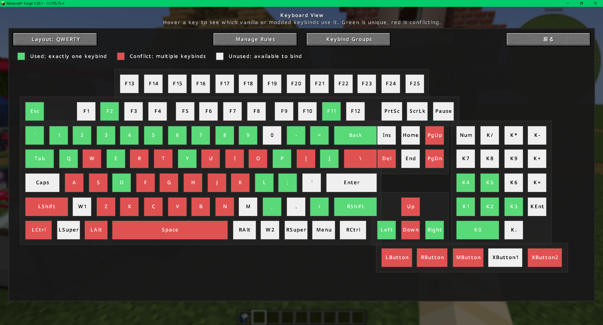
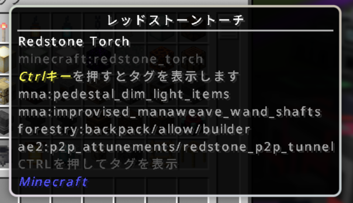
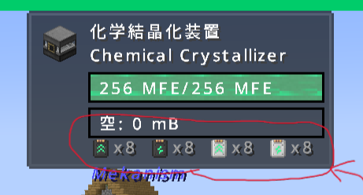
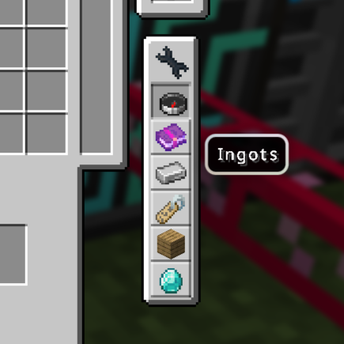

## おすすめ
### 🔸IMBlocker
日本語入力がダルくなくなる

### 🔸Mouse Tweaks
Shift + ドラッグで高速アイテム移動、マウスホイールでアイテムを1個ずつ移動

### 🔸Remove Reloading Screen
テクスチャリロードの MOJANG 画面が透過する

### 🔸ViewBoard
キーコンフィグを視覚的に確認できる

### 🔸Untranslated Items
アイテム名の日本語と英語(2言語)を同時に表示できる、検索もどちらでもできるようになる

以下と同時に適用するといい感じになる：
- Modern Font Pack
- Modern UI

ただし、

-> Esc メニュー > Mod > (Modern UI の設定) > Text(MC) > Use Text Component Cache を OFF にすること

## 軽量化
- CreateBetterFps
- Dynamic FPS
- Embeddium
- Entity Culling
- Immediately Fast

## お好み
### 🔸Durability Tooltip
JEI から最大耐久値を確認できる

### 🔸Item Highlighter
直前に拾ったアイテムをインベントリ内で強調表示する

### 🔸Just Enough Mekanism Multiblocks
Mek のマルチブロックを JEI で調べられるようにする

### 🔸MekaJadeUpgrades Unofficial
Mek を Jade に対応させる(例えば、アップグレードの状況が開かずに見れる)

### 🔸Storage Organizer
AE2 にカスタマイズ可能なフィルタタブを追加する

### 🔸その他リソース
- Comforts Modernized
- Complementary Shaders - Reimagined
- Oculus